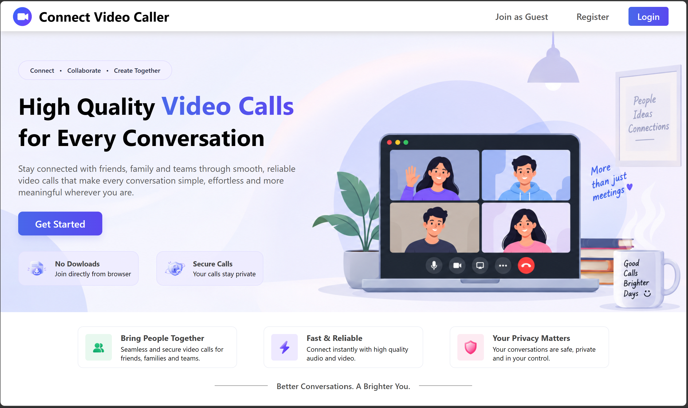
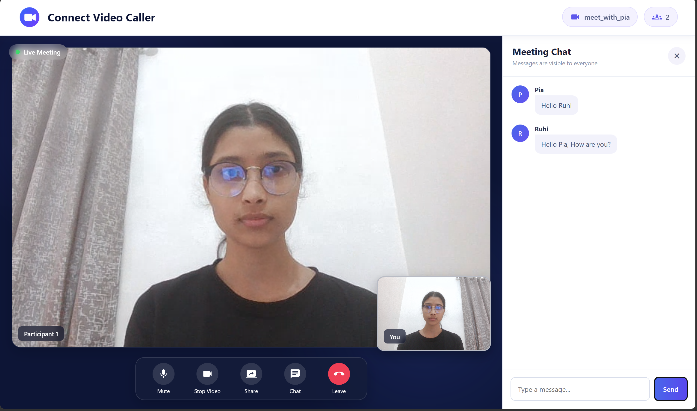

# Connect Video Caller

A full-stack video conferencing application built using the MERN stack, WebRTC, and Socket.IO. Connect allows users to communicate through real-time video calls, audio calls, and messaging.

## Features

- User registration and login with secure password hashing
- Join meetings using unique meeting IDs or as a guest
- Real-time video and audio communication
- In-meeting chat and camera/microphone controls
- Meeting lobby with audio and video preview
- Meeting history for registered users
- Responsive user interface

## Tech Stack

- **Frontend:** React.js, HTML, CSS
- **Backend:** Node.js, Express.js
- **Database:** MongoDB
- **Real-Time Communication:** WebRTC, Socket.IO
- **Authentication & Security:** bcrypt, Crypto

## Screenshots

### Landing Page


### Meeting Room


## Getting Started

Clone the repository:

```bash
git clone https://github.com/richa-chaudharyy/Connect.git
cd Connect
```

Install dependencies in both the `backend` and `frontend` directories using `npm install`.

Configure the required environment variables and MongoDB connection before starting the application.